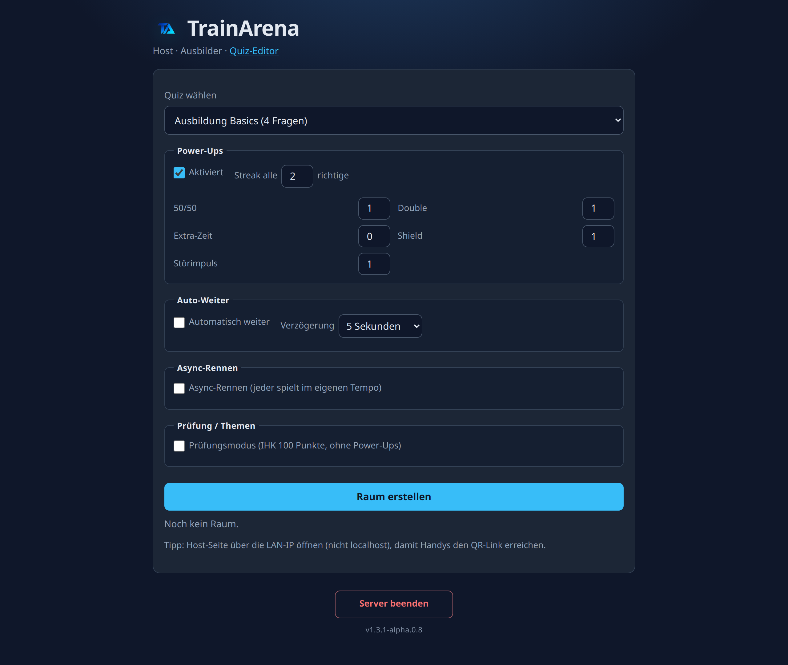
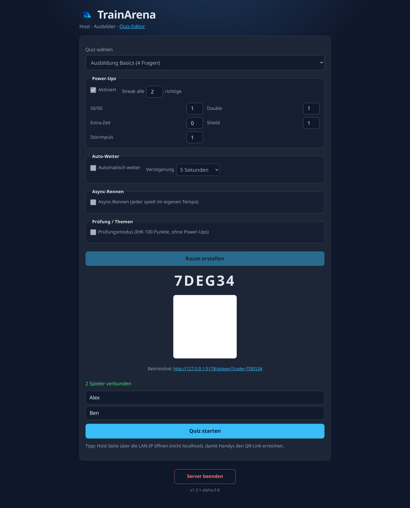
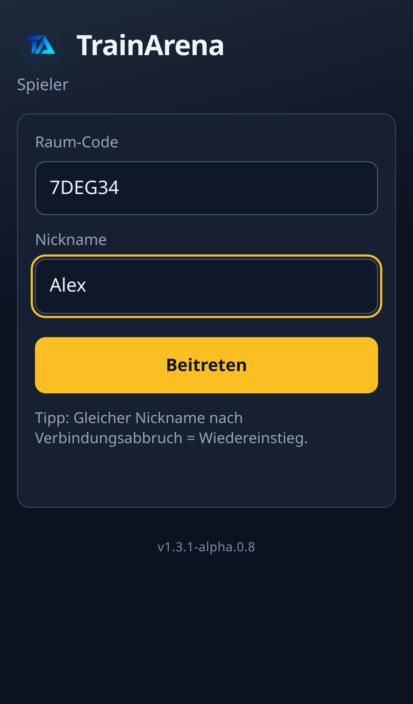
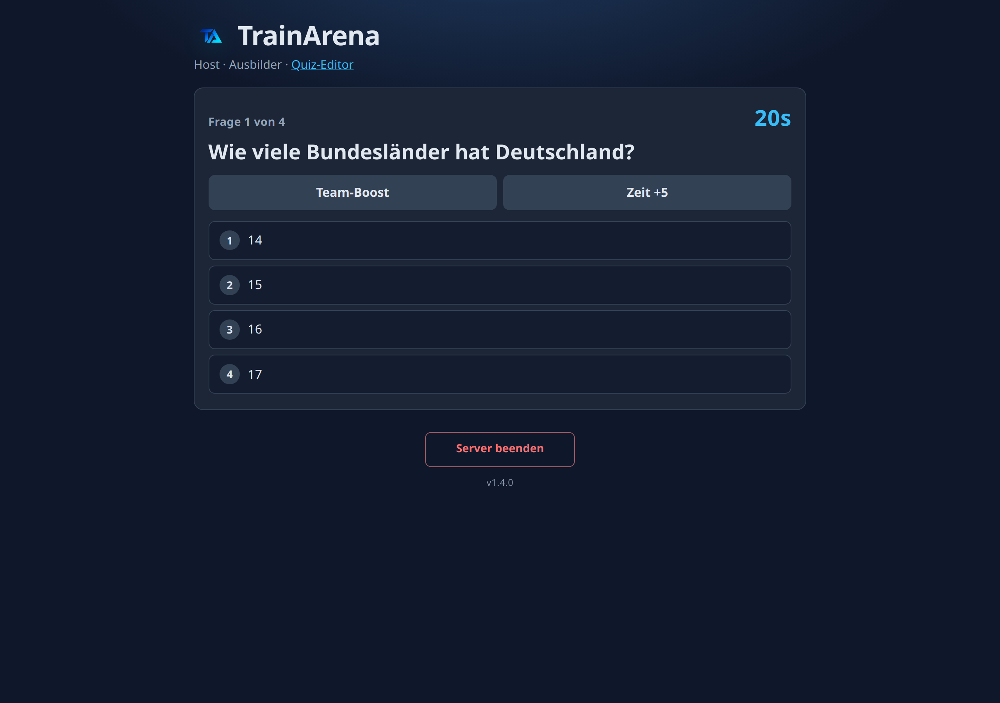
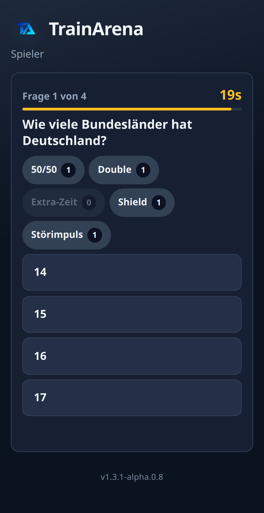
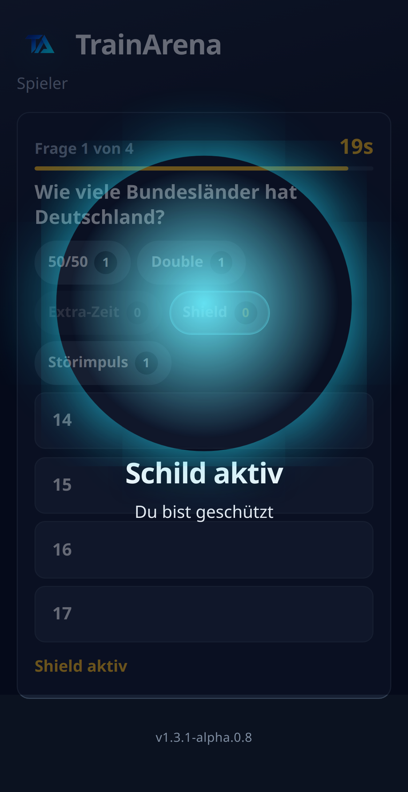
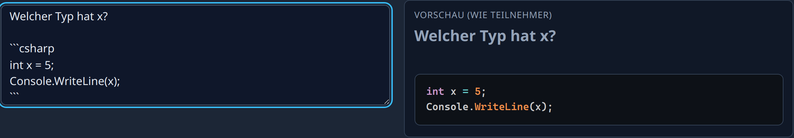

# TrainArena

[](https://github.com/tom4711/trainarena/actions/workflows/ci.yml)
[](https://github.com/tom4711/trainarena/releases/latest)
[](https://github.com/tom4711/trainarena/releases)
[](https://github.com/tom4711/trainarena/releases)
[](https://dotnet.microsoft.com/download)
[](LICENSE)

<p align="center">
  
</p>

Self-hosted Live-Quiz für **Ausbilder ↔ Azubis** (LAN-first, Kahoot-Alternative).

Ein ASP.NET-Core-Prozess: Host/Editor (Razor) · Player (HTML/JS) · SignalR · SQLite.

## Schnellstart

Voraussetzung: [.NET 10 SDK](https://dotnet.microsoft.com/download).

```bash
dotnet run --project src/TrainArena
```

Dann im Browser — am besten über die **LAN-IP** (nicht nur `localhost`), damit Handys den QR-Link erreichen:

| Rolle | URL |
|------|-----|
| Host (Ausbilder) | `http://<lan-ip>:5175/` |
| Spieler (Azubi) | `http://<lan-ip>:5175/player/` oder QR vom Host |
| Editor | `http://<lan-ip>:5175/Editor` |

1. Host: Quiz wählen → optional Power-Ups, Auto-Weiter, Async-Rennen oder Prüfungsmodus → **Raum erstellen** → Code/QR zeigen  
2. Spieler: Code scannen oder eingeben + Nickname → warten  
3. Host: **Quiz starten** → nach jeder Frage **Weiter**, oder beim Raumerstellen **Automatisch weiter** (3/5/10 s nach der Rangliste, standardmäßig aus)

### Screenshots

| | |
|:--|:--|
|  |  |
| *Host: Quiz, Power-Ups und Auto-Weiter* | *Lobby: Raumcode, QR, verbundene Spieler* |
|  |  |
| *Spieler: Code + Nickname (mobil)* | *Host live: Frage, Timer, Team-Boost / Zeit+5* |
|  |  |
| *Spieler: Frage inkl. Störimpuls & Shield* | *Arena-FX: Schild aktiv* |
|  | |
| *Editor: Live-Vorschau wie bei Teilnehmern (Syntax-Highlighting)* | |

### Firewall / LAN / UX

- Port freigeben (Dev-Standard: **5175**, siehe `src/TrainArena/Properties/launchSettings.json`).
- Host-Seite über `http://<deine-lan-ip>:5175` öffnen — `localhost` im QR funktioniert auf dem Handy nicht.
- Host und Player sind für Desktop und Mobile ausgelegt; große Arena-/Power-Up-Effekte nutzen Full-Screen-Overlays (`prefers-reduced-motion` wird respektiert).

### Daten

Quizzes liegen in SQLite (`trainarena.db` neben der App, EF Core). Beim ersten Start wird **Ausbildung Basics** geseedet. Fragebilder unter `wwwroot/uploads/` (max. **2 MB**, JPEG/PNG/WebP/GIF).

```bash
dotnet test TrainArena.sln
```

### Import CSV / JSON

Im Editor unter einem Quiz: **Import CSV / JSON**. Beispiele: [`docs/quizzes/`](docs/quizzes/).

**TrainArena-CSV** (Header-Zeile Pflicht):

```csv
Question,OptionA,OptionB,OptionC,OptionD,OptionE,OptionF,Correct,TimeLimitSeconds
Wie viele Bundesländer?,14,15,16,17,,,C,20
Zwei Antworten?,Ja,Nein,,,,,A,15
```

Mindestens **zwei** der Spalten `OptionA`…`OptionF` ausfüllen (ohne Lücken dazwischen); `OptionE` / `OptionF` optional für 5–6 Antworten.

`Correct`: Buchstabe `A`–`F` oder Index `0`–`5` (auch `1`–`6`). `TimeLimitSeconds` optional (Default 20). CSV-Import erzeugt immer Multiple-Choice (`DisplayKind=Mc`).

**Kahoot-ähnlich:** Excel-Vorlage als CSV speichern mit Spalten `Question`, `Answer 1`…`Answer 6` (mindestens zwei ausgefüllt), `Time limit`, `Correct answer(s)` (1-basiert). Kein natives `.xlsx` — bei Bedarf vorher als CSV exportieren. Ungültige Zeilen werden übersprungen.

**JSON-Quiz-Pack:** Wurzel entweder als Objekt mit `questions[]` oder als **direktes Fragen-Array** `[{ ... }, ...]`. JSON-Kommentare und nachgestellte Kommas sind erlaubt. Vollständiges Beispiel-Quiz: [`docs/quizzes/csharp-grundlagen-programmierung.json`](docs/quizzes/csharp-grundlagen-programmierung.json).

```json
{
  "title": "Optional — nur Metadaten, Quiz-Titel im Editor bleibt unverändert",
  "questions": [
    {
      "text": "Welcher Typ ist für Ganzzahlen gedacht?",
      "displayKind": "mc",
      "options": ["int", "double", "bool", "string"],
      "correctIndex": 0,
      "timeLimitSeconds": 20,
      "explanation": "Optional — nach Auflösung / im Fragen-Review",
      "tags": ["typen", "csharp"],
      "points": 5,
      "image": {
        "fileName": "diagramm.png",
        "contentType": "image/png",
        "base64": "iVBORw0KGgoAAAANSUhEUgAAAAEAAAABCAYAAAAfFcSJAAAADUlEQVR42mP8z8BQDwAEhQGAhKmMIQAAAABJRU5ErkJggg=="
      }
    },
    {
      "text": "C# ist statisch typisiert.",
      "displayKind": "trueFalse",
      "correctIndex": 0
    },
    {
      "text": "Was ist x?\n\n```csharp\nint x = 5;\n```",
      "options": ["5", "0", "10", "null"],
      "correctIndex": 0
    }
  ]
}
```

| Feld | Pflicht | Beschreibung |
|------|---------|--------------|
| `text` | ja | Fragetext (mehrzeilig ok). Code als Markdown-Fence im Text, z. B. ` ```csharp ` … ` ``` ` |
| `displayKind` | nein | `mc` (Standard) oder `trueFalse` (auch `true_false`, `tf`, `wahrfalsch`, `wahr_falsch`) |
| `options` | bei `mc` | 2–6 Strings, **ohne Lücken** in der Liste. Bei `trueFalse` entfallen — es werden automatisch `Wahr` / `Falsch` gesetzt |
| `correctIndex` | ja | **0-basierter** Index der richtigen Option |
| `timeLimitSeconds` | nein | 5–120; sonst **20** |
| `explanation` | nein | Freitext (wird bei >2000 Zeichen gekürzt) |
| `tags` | nein | String-Array für Themen-Filter beim Host (Prüfungsmodus) |
| `points` | nein | IHK-Gewichtung im Prüfungsmodus: `> 0` = Gewicht, `0`/fehlend = gleichmäßig (Summe der gespielten Fragen → 100 Punkte) |
| `image` | nein | `fileName`, `contentType` (JPEG/PNG/WebP/GIF), `base64` (roh oder `data:image/png;base64,...`). Max. **2 MB** |

Ungültige Fragen werden übersprungen; gültige werden trotzdem importiert (Hinweis mit Anzahl übersprungener Einträge).

Host und Player rendern Code-Fences mit Syntax-Highlighting (Prism, lokal unter `wwwroot/lib/prism/`).

**Editor (zusätzlich zum Import):** Fragetyp **Multiple Choice** (2–6 Optionen, genau eine richtig) oder **Wahr/Falsch**; optionale **Erklärung**, **Themen-Tags** und **IHK-Punkte**. **50/50** skaliert mit der Antwortanzahl: bei ≥4 Optionen zwei falsche ausblenden, bei 3 eine; bei 2 Optionen deaktiviert.

## Download (self-contained)

Ohne .NET-SDK und ohne Docker: unter [Releases](https://github.com/tom4711/trainarena/releases) das passende Archiv laden.

| Plattform | Archiv |
|-----------|--------|
| Windows x64 | `trainarena-win-x64.zip` |
| Linux x64 | `trainarena-linux-x64.tar.gz` |
| macOS (Apple Silicon + Intel) | `trainarena-osx-universal.zip` (`TrainArena.app`) |

Entpacken, Binary starten (`TrainArena.exe` bzw. `./TrainArena` / `TrainArena.app`), dann Browser auf `http://<lan-ip>:5175/`. Firewall-Port **5175** freigeben. SQLite liegt standardmäßig neben der App (`trainarena.db`); unter macOS `.app` in `~/Library/Application Support/TrainArena/`. Optional `TRAINARENA_DB` setzen.

**macOS:** Releases werden in CI als Universal Binary mit Developer ID signiert und notarized (Secrets siehe [`docs/MACOS_SIGNING.md`](docs/MACOS_SIGNING.md)).

Release bauen: Git-Tag `v*` pushen (z. B. `git tag v1.0.1 && git push origin v1.0.1`) — Workflow **Release** erzeugt die Archive. Trockenlauf: Actions → **Release** → **Run workflow**.

## Docker (LAN self-host)

Voraussetzung: Docker + Docker Compose.

```bash
docker compose up --build -d
```

Dann wie oben über `http://<lan-ip>:5175/` (Host/Player/Editor). Port-Mapping: **5175→8080** im Container.

Persistenz:

| Volume | Inhalt |
|--------|--------|
| `trainarena-data` | SQLite (`TRAINARENA_DB=/data/trainarena.db`) |
| `trainarena-uploads` | Fragebilder unter `/app/wwwroot/uploads` |

Stoppen: `docker compose down` (Volumes bleiben). Volumes mit löschen: `docker compose down -v`.

## Features (aktueller Stand)

- Text-MC-Editor (2–6 Optionen, 1 richtig) + Wahr/Falsch + optionale Bilder, Erklärungen und Themen-Tags; bestehende Fragen inline bearbeiten (inkl. Typwechsel MC ↔ Wahr/Falsch)
- CSV- / Kahoot-ähnlicher Import sowie JSON-Quiz-Pack (inkl. Erklärung/Tags/Punkte)
- Host-Raum + Code/QR-Join, Live-Runde, Server-Timer, Rangliste; nach dem Finale zeigt der Host ein **Fragen-Review** (Anteil richtig, Antwortverteilung, Erklärung/Tags)
- **Auto-Advance:** optional beim Raumerstellen — nach der Rangliste automatisch weiter (3/5/10 s; Host kann weiterhin manuell **Weiter** drücken)
- **Async-Rennen:** optional beim Raumerstellen — jeder Spieler bekommt die Fragen in **eigener Reihenfolge** (Shuffle) und mit **eigenem Timer**; der Host sieht Live-Punkte und Fortschritt **x/n** (ohne Fragetext). **Nicht kombinierbar** mit Prüfungsmodus oder Auto-Advance. Power-Ups inkl. Störimpuls gelten wie im Sync-Modus; das Rennen endet automatisch, wenn **alle** fertig sind → Abschluss-Rangliste.
- **Prüfungsmodus (IHK):** optional beim Raumerstellen — ohne Power-Ups, optionale Themen-Filter (ODER), Punkte/Note nach IHK-Schema (100-Punkte-Skala); Erklärungen erst im Review, nicht live während der Frage
- Classroom-Größe ~≤40, ein Prozess
- **Power-Ups** (siehe unten); self-contained Releases für **Windows / Linux / macOS**

## Power-Ups

Beim **Raum erstellen** kann der Host Power-Ups aktivieren, Starter-Anzahlen setzen und die Streak-Belohnung konfigurieren (Standard: alle 2 richtigen Antworten ein zufälliges Spieler-Power-Up).

### Spieler

Während einer offenen Frage (vor der eigenen Antwort), inkl. Inventar-Buttons und Aktivierungs-/Effekt-Animationen:

| Power-Up | Wirkung |
|----------|---------|
| **50/50** | Falsche Optionen ausblenden (2 bei ≥4 Antworten, 1 bei 3; nicht bei Wahr/Falsch) |
| **Double** | Nächste richtige Antwort ×2 |
| **Extra-Zeit** | +5 s Fragezeit (einmalig pro Frage für den Raum) |
| **Shield** | Blockt den nächsten **Störimpuls** gegen dich und wird dabei verbraucht |
| **Störimpuls** | Angriff auf einen Gegner (Zielwahl oder zufällig): nächste Antwort des Ziels zählt 0 Punkte / kein Streak — außer Schild blockt |

Self-Effects (50/50, Double, Extra-Zeit) sind pro Frage exklusiv; Störimpuls ist davon getrennt und mit ihnen kombinierbar.

### Host (Arena)

Während einer offenen Frage (ein Event pro Frage, serverseitig):

| Power-Up | Wirkung |
|----------|---------|
| **Team-Boost** | Alle Punkte dieser Frage ×1,5 |
| **Zeit +5** | Fragezeit um 5 s verlängern |

### Arena-FX

Wettbewerbs-Power-Ups (Schild / Störimpuls) senden Full-Screen-Overlays an Host und Spieler: Schild aktiv, Schild zerstört, Angriff ausgelöst, Treffer, Geblockt. Punkte, Inventar und Timer werden **nur auf dem Server** berechnet; die UI spiegelt den Stand.

## Scope vs Non-Goals

**Im Scope:** self-host (LAN / Docker / native Releases), Classroom, Editor, Live-Runde, Auto-Advance, Async-Rennen, Prüfungsmodus (IHK), Power-Ups inkl. Arena-FX.

**Nicht im Scope:** öffentliche Demo-/Cloud-Hosting-Instanz · App-Store · Marketplace · Aula-Scale · SSO.

## CI / Release

| Workflow | Trigger | Inhalt |
|----------|---------|--------|
| **CI** (`.github/workflows/ci.yml`) | PR + Push `main` | `dotnet restore` / `build` / `test` |
| **CI** Docker-Job | nur Push `main` | `docker build` mit MinVer-Version (Smoke, kein Registry-Push) |
| **Release** (`.github/workflows/release.yml`) | Tag `v*` (oder manuell) | self-contained Publish; macOS auf `macos-14` mit Developer-ID-Signatur + Notary (siehe `docs/MACOS_SIGNING.md`) |

### Versionierung

[MinVer](https://github.com/adamralph/minver) liest SemVer aus Git-Tags mit Prefix `v` (z. B. `v1.3.0`). CI/Release checken mit `fetch-depth: 0`. Die Version steht im Binary, unter `/health` (`version`) und dezent in Host-, Editor- und Player-UI.

```bash
git tag v1.0.0
git push origin v1.0.0   # baut Release-Assets mit Version 1.0.0
```

Zwischen Tags: `1.0.1-alpha.0.N` (Höhe seit dem letzten Tag). Docker lokal: `docker build --build-arg APP_VERSION=1.0.0 .` (ohne Arg: `0.0.0`).

## Cloud Agent

Das Cursor-Environment ist dashboard-managed. `install` führt
[`scripts/cloud-agent-install.sh`](scripts/cloud-agent-install.sh) aus (.NET SDK 10 in `~/.dotnet`, optional `dotnet restore`).

## Lizenz

MIT — siehe [LICENSE](LICENSE).
